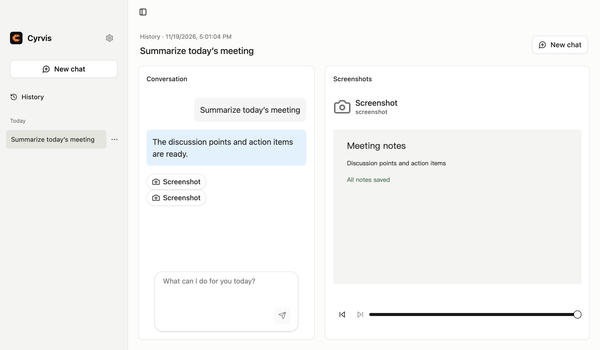
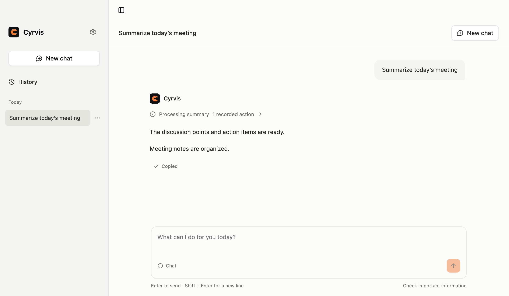
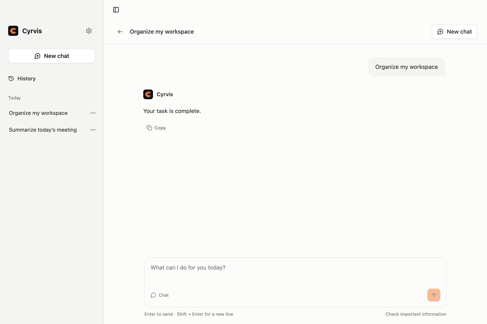
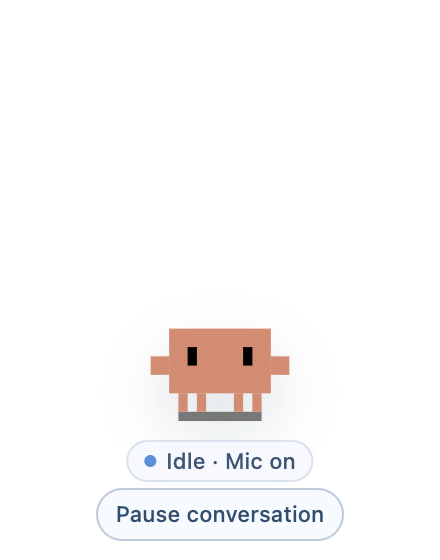

# Cyrvis UI refresh

The refresh replaces the split conversation/screenshot layout with a single
conversation column in live and saved chats. Recorded actions appear in a
collapsible processing summary, followed by the Markdown answer and a copy
button. Active tasks show their actual status. Raw model thought/reflection
fields are not rendered, and existing screenshot records remain in storage.

The composer uses the orange brand accent and retains send, stop, resume,
history continuation and concurrent-task guards. Compact windows and reduced
motion preferences are supported.

## Chat comparison

These screenshots come from the isolated Electron regression profile with
synthetic meeting-note data. The before image already has the new logo; it
documents the previous chat layout.

| Before | After |
| --- | --- |
|  |  |

## Clawd appearance

Artwork provenance, state mapping and the unresolved upstream license terms
are documented in [the Clawd pack README](../../apps/ui-tars/resources/cyrvis-companion/skins/clawd/README.md).
The new orange arcade C artwork and rebuild instructions are in
[the logo source directory](../cyrvis-logo/v4/README.md).
